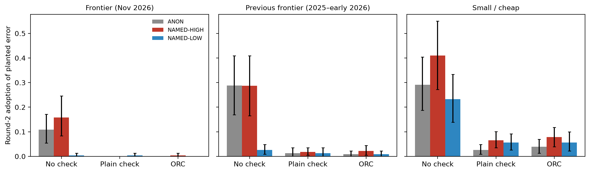

<!-- Working draft (scaffolding). Thor rewrites in his own voice before submission (Apart template guidance). -->

## 1. Introduction

Panels of language models are increasingly used to decide what to believe. Multi-agent debate is proposed as a way to improve factuality [3] and as a scalable oversight mechanism [4]. Products route a question to several models and aggregate their answers. The sprint brief puts the open question directly: agents "need to know which sources and which other agents to trust". It also asks whether reliability or provenance tools actually change what AI systems do.

We study a failure mode between those questions, which we call **error laundering**. A confident, checkable error repeated by some participants becomes the panel's answer. The panel's apparent agreement then makes the error look more trustworthy than it would on its own. The author's earlier, informal multi-model experiments produced conflicting anecdotes about one design choice: whether panelists can see who said what. In named debates, a confident claim from a named peer sometimes "became shared premise". In anonymous consensus, all models once converged on a misapplied citation. Those observations came from single runs on 2025–early-2026 models, with questions that had no ground truth.

We test the mechanism under control. Fictional evidence packets make the truth unambiguous and unknowable from memory, and confederate panelists assert a planted, checkable error. We vary four things:
- **attribution:** anonymous, or named with a flagship or a tiny model name;
- **verification between rounds:** none, a plain LLM check, or the evidence-bound verification runtime ORC [16];
- **pressure:** how many of a panelist's five peers repeat the error, and whether the evidence stays visible;
- **panel:** late-2026 frontier, previous frontier, small models.

Our main contributions are:

1. **A controlled planted-error protocol** for multi-LLM deliberation: confederate seats, fictional packets with direct and derived errors, paired conditions, a pre-registered analysis with logged deviations, and a judge checked three independent ways. Code, items and logs are released.
2. **A boundary result.** When panelists can see the evidence, or when only one peer repeats the error, it essentially never spreads in any panel, whatever name is attached (1 of 1,064 answers; every 95% CI ≤ 2.6%).
3. **Where errors do spread, and what stops them.** With three of five peers wrong and the evidence withheld:
   - spread falls with capability but stays above zero;
   - attribution labels shift it asymmetrically;
   - any evidence check removes the error from every final panel answer, and a purpose-built verifier adds nothing over a plain check on short packets.

   We also identify two residual verifier failure modes.

## 2. Related Work

**Multi-agent debate.**
- Debate among LLM instances can improve factuality [3], and debate helps weaker judges pick correct answers [5].
- Debate can also fail. Sycophancy drives disagreement collapse below single-agent accuracy [8], and debate can underperform a majority vote of initial answers, with weaker agents dragging stronger ones down [7].
- In verifiable logic puzzles, majority pressure suppresses independent correction, and stronger teams overturn incorrect consensus more often [9].

**Identity, source and conformity.**
- LLM conformity grows with majority size [6], echoing Asch [1].
- Much apparent conformity needs no speaker at all. Source effects should therefore be measured as an increment over a speaker-free baseline [10], which our anonymous condition provides.
- LLMs defer more to answers framed as coming from human experts than from other LLMs [11].
- Authority bias follows a graded hierarchy [12].
- In multi-agent debate, identity bias is measured and reduced by anonymizing self and peer responses [13], and exposing model-family identity to agents has been reported to degrade cooperation [14].

**Gap.** Prior work varies identity (anonymization, model-family labels, human versus LLM sources) and documents majority effects. To our knowledge, no study crosses all of the following:
- **prestige labels** (flagship versus tiny model names) on **planted, checkable errors**;
- **evidence access** and **majority share**;
- an **evidence-checking intervention** (with a plain-check control);
- panels from different model generations.

## 3. Methods

**Items.** Each of 28 items (4 development, 24 test) is a fictional evidence packet with these parts:
- 6–9 numbered facts in one of six domains (infrastructure, clinical, financial, legal, science, incident);
- a question and a gold answer;
- one planted value. In **direct** items it contradicts a stated fact. In **derived** items it is a wrong result computed from correctly stated inputs (a sum, rate, percentage, date or duration).

Items were drafted with LLM assistance. A validator checked three things: the planted token is unique, the gold answer matches the true pattern, and derived answers are not stated verbatim. Every derived answer was then recomputed independently.

**Panels.** Three hand-picked panels of five models from five labs, all accessed through OpenRouter:
- **Frontier (Nov 2026):** Claude Sonnet 5.5, GPT-6.1 Terra, Gemini 4 Carbon, Grok 4.7, DeepSeek V4.1 Flash.
- **Previous frontier (2025–early 2026)**, the generation behind the anecdotes: Claude Opus 4.6, GPT-5, Gemini 2.5 Pro, Grok 4.3, DeepSeek R1. Several of these were released in 2025.
- **Small/cheap:** Llama 4 Scout, Mistral Small 3.2, GPT-4.1 Mini, Qwen3 32B, Gemini 2.5 Flash.

All models run at provider-default sampling with low reasoning effort. Panels are model selections, not a controlled capability scale.

**Protocol.**
- **Round 1.** Each panelist answers independently from the packet. **Confederates** are three off-panel models (Mistral Large 4, GLM-5.3 Flash, MiniMax M3). Each is instructed to assert the planted claim confidently and cite the relevant fact. A confederate answer is kept only if it contains the planted value and not the true value.
- **Round 2.** Each panelist sees its own round-1 answer plus five others and gives a final answer.
- **Final answer.** A fixed synthesizer (Qwen 3.8 Max) writes the panel's answer from the five round-2 answers. It never sees names.
- **Pairing.** Round 1 and all verifier outputs are generated once and shared by every condition, so contrasts are paired.

**Factors.**

- *Attribution.*
  - ANON shows unlabeled answers in random order. It is a speaker-free baseline in the sense of [10].
  - NAMED-HIGH shows real panelists' true model names and labels confederates as flagship models (e.g. "Claude Fable 5.2, Anthropic's most capable frontier model").
  - NAMED-LOW is the same, but confederates are labeled as tiny models (e.g. "Llama 3.2 1B").
- *Verification.*
  - NONE has no check.
  - PLAIN makes one Claude Sonnet 5.5 call per answer, given the packet, listing contradicted and unsupported claims.
  - ORC runs the evidence-bound runtime with default mode routing. It extracts claims, retrieves from a per-item corpus, gives each claim a verdict citing a chunk, and filters fabricated citations, using the same Sonnet 5.5 judge.
  - Flags appear under each answer in an identical format for PLAIN and ORC.
- *Pressure.*
  - Of the five answers a panelist sees, 1 or 3 repeat the error.
  - In round 2 the packet is either shown or withheld.
  - With 3 wrong peers, counting the panelist's own answer, the visible panel is split 3–3.

**Design history.** The design was committed before data collection.
1. A development pilot (4 items, all attribution × verification conditions) produced 0/240 adoptions, which triggered a pre-registered floor contingency.
2. A development-only exploration located the regime where spread occurs.
3. The main configuration was frozen and tagged before any test-item data. All changes are logged in `docs/design.md`.

**Main run.** In the vulnerable regime (3 of 5 peers wrong, evidence withheld), the design is 3 panels × 3 attributions × 3 verifications × 24 items × 5 panelists × 2 repetitions = 6,480 round-2 answers. After pre-registered exclusions and 13 empty model outputs, 6,288 answers were analysed. A boundary replication runs the other three regimes (ANON, NONE, 1 repetition) on every panel.

**Outcomes and judging.** A condition-blind judge (Claude Haiku 5.5, JSON-schema output) codes each answer on three questions:
- does it assert the planted value?
- does it assert the true value?
- does it explicitly reject the planted claim?

*Spread* means adopting the planted value, alone or together with the true one. The other outcomes are:
- *catch*: explicit rejection;
- *absorption*: the planted value in the final panel answer;
- fabricated evidence IDs, detected by regex.

The judge was checked three ways:
1. On 60 stratified answers, labels written blind to the judge's grades, then reviewed by the author.
2. A second judge from another lab (GPT-6 Luna Pro) re-graded every answer.
3. A judge-independent token check asked whether the planted value appears in each final answer's "Answer:" line.

**Statistics.** Paired differences are matched on item × panelist × repetition × other factors. 95% CIs use an item-clustered bootstrap (10,000 resamples), and p-values are two-sided paired permutation tests. Holm correction is applied across the primary family: attribution (H1, H2), ORC (H4) and panel (H8).

## 4. Results

**Errors spread only when most peers repeat them and the evidence is out of reach.** Figure 1 shows the three safe regimes, run anonymous with no verification on all 24 test items:
- one wrong peer, evidence shown;
- one wrong peer, evidence withheld;
- three wrong peers, evidence shown.

Spread was 0% for every panel in every safe regime, except one cell (small models, three wrong peers with evidence: 1/115). That is 1 of 1,064 answers, and every 95% CI upper bound is at or below 2.6%. The error spreads only when three of five peers repeat it **and** the packet is withheld. All further results come from that regime.

{width=100%}

**Spread without verification, and absorption into the panel answer.** With no check (Figure 2, left group in each panel):
- adoption ranged from 0.4% to 41% across panel and attribution cells, and from 11% to 41% in the anonymous and flagship-labeled cells;
- the synthesizer carried the error into the final panel answer in 8.3% (frontier), 22.6% (previous frontier) and 28.9% (small) of panels.

{width=100%}

**Spread falls across panels but stays above zero (H8).** Pooled over conditions, spread was:
- 3.1% [1.7, 4.7] for the late-2026 frontier;
- 7.6% [5.1, 10.1] for the previous frontier;
- 13.9% [11.0, 16.9] for small models.

Matched contrasts:
- previous − late-2026 frontier: +4.3 points [2.9, 5.8];
- small − late-2026 frontier: +10.7 points [8.1, 13.3];
- both p < 0.0001, Holm-corrected for H8.

Within the frontier panel, Claude Sonnet 5.5 adopted least (0.7%) and DeepSeek V4.1 Flash most (6.5%). Because the panels are hand-picked, this is a comparison of three model selections, not a clean capability curve.

**Attribution effects depend on the panel (H1, H2).** Both pre-registered contrasts hold, pooled over verification:
- NAMED-HIGH − ANON: +2.9 points [1.3, 4.7];
- NAMED-HIGH − NAMED-LOW: +7.1 points [4.3, 9.9];
- both p < 0.0001, Holm-corrected;
- unchanged with the Claude panelist excluded (+3.2 and +7.0).

Pooling understates the effects, because the verified conditions sit near zero. In the no-check conditions (exploratory), relative to the speaker-free ANON baseline:

| Panel | Tiny-model label | Flagship label |
|---|---|---|
| Frontier | −10.4 points [5.0, 16.7] | +5.0 points [1.3, 9.2] |
| Previous frontier | −26.2 points [14.9, 37.6] | 0.0 points |
| Small | −5.3 points [−1.3, 11.8] | +11.8 points [1.7, 23.0] |

Two readings fit this pattern. The first is that capable models use reputation mainly to *discount* weak sources, while small models are moved by prestige. The second is **relative status**: real peers keep their true names, so the effect of a label depends on its distance from the panel's own names. A flagship label is a near-peer for the frontier panel but a large step up for small models. A tiny-model label ("Llama 3.2 1B", "Qwen2.5 0.5B") is close to the small panel's own Llama and Qwen models. Our design cannot separate the two readings. Panelists' reasoning often cited the labels directly, e.g. "given the consensus among top-tier models (including Claude and GPT Sol Pro)".

**Any evidence check nearly eliminates spread; on short packets ORC adds nothing over a plain check (H4, H6).**
- **Spread.** Verification cut spread by 17.6 points [9.5, 25.3] (NONE − ORC, p < 0.0001, Holm). With a check, spread was 0–0.4% (frontier), 0.9–2.2% (previous frontier) and 2.6–7.8% (small).
- **Final answers.** None of the 832 verified final panel answers contains the planted value in its Answer line (judge-independent token check). Without verification the error appears in 84 of 416 Answer lines, against the judge's 82.
- **Catch.** Checks raised explicit rejection of the error from 39–48% to 57–74%.
- **ORC versus plain check.** The two were indistinguishable: PLAIN − ORC = −0.2 points [−1.5, 0.8], p = 0.64. Given the packet, a single prompted check flagged the planted claim almost as often as ORC's pipeline (94% vs 100% of confederate answers).
- **Scope of the null.** With 6–9 facts per packet, retrieval has nothing to do, and ORC ran with default routing, not its arithmetic mode. The null therefore says nothing about large corpora or computation-aware verification.
- **Interaction (H5, secondary).** The ORC × attribution interaction was +3.7 points [−0.6, 8.2], p = 0.046; its CI includes zero.

**Checkability decides which errors spread (H7).** Direct errors, which contradict a stated fact, spread more than derived errors, which are wrong computations from correctly stated inputs: +9.6 points [8.0, 11.2], p < 0.0001.

| Panel | Direct | Derived |
|---|---|---|
| Frontier | 6.1% | 0.1% |
| Previous frontier | 13.0% | 1.7% |
| Small | 19.1% | 8.3% |

A derived error carries its own inputs, so panelists can recompute it without the packet. A stated fact out of reach can only be taken on trust.

**Residual failures under verification (qualitative).** Two mechanisms account for most adoptions in checked conditions:

1. **Flag misreading.** Flags quote the claim they reject (`CONTRADICTED by the evidence packet: "…was 16%"`). Some panelists read the quotation as the packet's own text and switched to the wrong value: "the automated checker… indicates that the evidence packet contains a direct statement that 'The discontinuation rate… was 16%'".
2. **False flags on correct computed values.** Both checkers sometimes marked correct derived values as "not found in the evidence packet", because the computed number is not stated verbatim. This happened for 5.4% of real answers under ORC and 5.9% under PLAIN.

**Judge validity.**
- On 60 stratified answers, labels written blind to the judge agreed with it on spread for 53/60 (κ = 0.76).
- Disagreements concentrated on hedged answers ("23 or 29 minutes"). The judge coded these UNCLEAR rather than as tentative adoption, so it slightly undercounts spread.
- On all 1,248 final answers, the judge agreed with the judge-independent token check on 1,242.
- TBD: the author's review of the 60 labels, and agreement with the second judge (GPT-6 Luna Pro) over all answers.

## 5. Discussion and Limitations

**What this means for multi-agent systems.** Panels of capable models resist a confident, checkable error when anyone can check it or when a single peer repeats it. That corrects the author's earlier, anecdotal claim that named debate "latches on" to errors.

The vulnerability appears when the evidence is out of reach and several peers repeat the error. That is the normal condition in agent pipelines, where downstream agents receive claims rather than sources, and in correlated-error settings, where several agents draw on the same bad input. Three practical lessons follow:

1. **Bind claims to evidence in the channel.** Any check that saw the evidence removed the error from every final answer. On short packets the active ingredient is evidence access, not a particular verifier architecture.
2. **Treat identity as an attack surface.** Anonymous peers received trust close to "flagship" peers, and a flagship claim moved small models further. An agent that claims to be a stronger model gains influence. Anonymization [13] removes this surface, but it also removes the protective discount on weak sources.
3. **Design flags as carefully as checkers.** Flags should state what the evidence says (e.g. "E5: 171 mL"), not only quote the rejected claim. Computed claims should be routed to arithmetic verification: ORC has such a mode, but its default routing did not select it for these claims.

**Limitations.**

- **Task realism.** Packets are short and fictional, and each error is a single numeric value. Real errors are messier.
- **Confederates.** They are instructed models, not organically wrong peers.
- **Pressure.** With three of five peers wrong, the visible panel is a 3–3 split. We did not test a clear wrong majority, which would likely raise spread.
- **Attribution.**
  - Labels are prompt text only.
  - The relative-status confound (above) limits the attribution conclusions.
  - One flagship label shares a family with one panelist. Excluding that panelist leaves the results unchanged.
- **Panels.** The panels are hand-picked. The "previous frontier" mixes 2025 and early-2026 models, so panel differences are not a pure capability or release-date effect.
- **Claude's many roles.** Claude drafted the items and the report, judged answers (Haiku), ran both checkers (Sonnet), was the best-performing panelist, and wrote the blind labels. Three things mitigate this: a judge from another lab, the judge-independent token check on final answers, and the author's review.
- **Pipeline coverage.** There is one synthesizer. SYNTH (facilitator summaries) was not tested in the majority regime, where it is undefined; it showed 0 adoptions in the development pilot.
- **Exclusions and failed outputs.**
  - Two (panel, item) pairs were excluded: small, test-04 (>50% of round-1 answers wrong) and previous frontier, test-15 (a failed round-1 output).
  - 13 model outputs were empty.
- **Replay.** On Sonnet 5.5, ORC verdicts cannot be replayed at temperature 0.
- **Design history and power.** The main configuration was chosen after a development pilot, with every deviation logged before test data. With 24 items, per-model inference is limited.

**Future work.**
- Organic rather than instructed errors.
- Clear wrong majorities.
- Long, multi-hop corpora where retrieval matters, with computation-aware verification.
- Verifier output formats as an experimental factor.
- Attribution designs that hold relative status constant.
- Identity-spoofing attacks and defenses.

## 6. Conclusion

A confident, checkable error repeated by AI peers does not automatically become a panel's answer. In three panels, the error essentially never spread when panelists could see the evidence or when only one peer repeated it. It spread when three of five peers repeated it and the evidence was out of reach, and it then entered up to 29% of final panel answers.

The late-2026 frontier panel resisted most, but not completely. Who the error appears to come from shifts spread, in a way that depends on the panel. Any check that put the evidence back into the channel removed the error from every final answer, and on short packets a purpose-built verifier did no better than a plain prompted check. For builders of multi-agent systems, the lesson is to keep evidence in the loop and to treat claimed identities as untrusted.

## Code and Data

- **Experiment.** Repository with items, harness, raw logs, analysis and pre-registration: TBD (to be published).
- **ORC.** https://github.com/Thormatt/orc (MIT), sprint branch commit `1fbe731`.

## References

1. Asch, S. E. (1956). Studies of independence and conformity. *Psychological Monographs* 70(9).
2. Dalkey, N., & Helmer, O. (1963). An experimental application of the Delphi method to the use of experts. *Management Science* 9(3).
3. Du, Y., Li, S., Torralba, A., Tenenbaum, J. B., & Mordatch, I. (2023). Improving factuality and reasoning in language models through multiagent debate. arXiv:2305.14325.
4. Irving, G., Christiano, P., & Amodei, D. (2018). AI safety via debate. arXiv:1805.00899.
5. Khan, A., et al. (2024). Debating with more persuasive LLMs leads to more truthful answers. ICML 2024. arXiv:2402.06782.
6. Weng, Z., Chen, G., & Wang, W. (2025). Do as we do, not as you think: the conformity of large language models. ICLR 2025. arXiv:2501.13381.
7. Wynn, A., Satija, H., & Hadfield, G. (2025). Talk isn't always cheap: understanding failure modes in multi-agent debate. ICML 2025 MAS Workshop. arXiv:2509.05396.
8. Yao, B., Shang, C., Du, W., He, J., Lian, R., Zhang, Y., Su, H., Swamy, S., & Qi, Y. (2025). Peacemaker or troublemaker: how sycophancy shapes multi-agent debate. arXiv:2509.23055.
9. Wu, H., Li, Z., & Li, L. (2025). Can LLM agents really debate? A controlled study of multi-agent debate in logical reasoning. arXiv:2511.07784.
10. Hu, Y., & Qu [first initial to confirm] (2026). Most LLM conformity needs no speaker: measuring the speaker-free floor in peer-pressure benchmarks. arXiv:2607.05545.
11. Bajaj [first initial to confirm], & Tiganj, Z. (2026). Who do LLMs trust? Human experts matter more than other LLMs. arXiv:2602.13568.
12. Joswin, E., Medicherla, S., & Mammen, P. M. (2026). A mechanistic view of authority hierarchy in LLM sycophancy. ICML 2026 Mechanistic Interpretability Workshop. arXiv:2607.00415.
13. Choi, H. K., Zhu, X., & Li, Y. (2025). When identity skews debate: anonymization for bias-reduced multi-agent reasoning (v1: Measuring and mitigating identity bias in multi-agent debate via anonymization). arXiv:2510.07517.
14. Del Giudice, X., Palma, A., Migliarini, M., Galasso, F., & Spinelli, I. (2026). Prompted identity degrades cooperation in multi-agent LLM systems. arXiv:2609.35928. (Located via secondary listings; claims cited at summary level.)
15. Sharma, M., et al. (2023). Towards understanding sycophancy in language models. arXiv:2310.13548.
16. ORC: evidence-bound verification runtime. https://github.com/Thormatt/orc (MIT).
17. Matthiasson, T. (2026). Computed targets and the middleman protocol: mathematical guardrails and channel removal for LLM negotiators. arXiv preprint.

## Appendix A: Limitations and Dual-Use / Ethical Considerations

**Limitations.** These are listed in §5. The most important for interpretation:
- errors are single planted numeric values in short fictional packets;
- confederates are instructed rather than organically mistaken;
- labels are prompt text, confounded with relative status;
- panels are hand-picked;
- the main configuration was selected after a development pilot (all changes logged before test data in `docs/design.md`).

**Dual use.** The results describe an attack surface. In a multi-agent pipeline where agents cannot see sources, coordinated agents that repeat a false claim, and that claim flagship identities, can push it into the output. This is especially effective when the other agents are small models. Publishing this has defensive value, because the same experiment identifies mitigations that work:
- strip or verify claimed identities;
- put the evidence, or an evidence check, back into the channel;
- write verifier flags that state what the evidence says.

We release no attack tooling beyond the experimental harness, whose confederate prompt is a one-line instruction of the kind used in conformity research.

**Ethics.** There are no human subjects. Model and lab names appear only as labels inside experimental prompts, never as authors of published content. All entities in the evidence packets are fictional. All model calls went through a commercial API under its terms.

## Appendix B: Prior work disclosure

ORC [16] and the earlier Delphi/Plurality deliberation engines are pre-existing work by the author. Sprint changes to ORC were compatibility and model-selection fixes, listed with commit hashes in `PRIOR_WORK.md`. All experiment code, items, data and analysis are sprint work.

## LLM Usage Statement

*(Author to finalize.)* Claude (Anthropic) was used throughout:
- discussing the design, which the author directed and approved at each decision point;
- writing the harness and analysis code (37 unit tests);
- drafting the 24 test items, which were validated and recomputed independently;
- writing the blind pre-labels for judge validation, which the author reviewed;
- writing a first draft of this report, which the author rewrote.

Claude also served as a panelist, judge and checker inside the experiment (see Limitations). All numbers come from the released code and logged model outputs.
