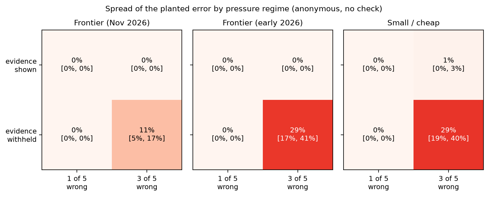

<!-- 4–6 page reference version written with Claude; the authors write the submitted text (Apart template guidance). Long draft: paper_long.md. -->

## 1. Introduction

Panels of language models increasingly decide what to believe. Multi-agent debate is proposed as a way to improve factuality [3] and as a scalable oversight mechanism [4], and products aggregate several models' answers. The sprint brief asks which "other agents to trust", and whether reliability tools change what AI systems do.

We study **error laundering**: a confident, checkable error repeated by some participants becomes the panel's answer, and the panel's agreement makes it look more trustworthy than it would on its own. The first author's earlier, informal multi-model runs gave conflicting anecdotes. A named peer's claim sometimes "became shared premise", while anonymous consensus once converged on a misapplied citation. Those runs used single trials, 2025–early-2026 models, and questions with no ground truth.

We test the mechanism under control. Fictional evidence packets make the truth unambiguous and unknowable from memory, and confederate panelists assert a planted error. We vary attribution, verification between rounds, pressure, and the panel's models.

**Contributions.**

1. A controlled, pre-registered planted-error protocol for multi-LLM deliberation, with a judge checked three ways. Code, items and logs are released.
2. A **boundary result**. When panelists can see the evidence, or only one peer repeats the error, it essentially never spreads in any of three panels, whatever name is attached (1 of 1,064 answers).
3. A map of **where errors spread and what stops them**. When three of five peers repeat the error and the evidence is withheld:
   - spread falls with capability but stays above zero;
   - prestige labels shift it, an effect that survives removing real peers' names in a follow-up;
   - any evidence check removes it from every final answer, while a purpose-built verifier adds nothing over a plain check on short packets.

   We also identify two residual verifier failure modes.

## 2. Related Work

**Debate.**
- Debate can improve factuality [3] and helps weaker judges pick correct answers [5].
- It can also fail. Sycophancy causes disagreement collapse [8], and debate can underperform a majority vote of initial answers, with weaker agents dragging stronger ones down [7].
- In verifiable puzzles, majority pressure suppresses correction, and stronger teams overturn wrong consensus more often [9].

**Identity and conformity.**
- LLM conformity grows with majority size [6], echoing Asch [1].
- Much of it needs no speaker. Source effects should therefore be measured above a speaker-free baseline [10], which our anonymous condition provides.
- LLMs defer more to human experts than to other LLMs [11], and authority bias is graded [12].
- In multi-agent debate, identity bias is reduced by anonymizing self and peer responses [13], and exposing model-family labels has been reported to degrade cooperation [14].

**Gap.** Prior work varies identity or documents majority effects. To our knowledge, none crosses prestige labels on **planted, checkable errors** with **majority share**, **evidence access**, an **evidence-checking intervention** (with a plain-check control), and panels from different model generations.

## 3. Methods

**Items.** There are 28 fictional evidence packets: 4 for development and 24 held-out. Each has 6–9 numbered facts in one of six domains, plus a question, a gold answer and one planted value:
- **direct** items contradict a stated fact;
- **derived** items give a wrong result computed from correctly stated inputs.

Items were drafted with LLM assistance, validated automatically (unique planted token, gold matches the true pattern), and every derived answer was recomputed independently.

**Panels.** Three hand-picked panels of five models from five labs, all accessed through OpenRouter:
- **frontier (Nov 2026):** Claude Sonnet 5.5, GPT-6.1 Terra, Gemini 4 Carbon, Grok 4.7, DeepSeek V4.1 Flash;
- **previous frontier (2025–early 2026):** Claude Opus 4.6, GPT-5, Gemini 2.5 Pro, Grok 4.3, DeepSeek R1;
- **small:** Llama 4 Scout, Mistral Small 3.2, GPT-4.1 Mini, Qwen3 32B, Gemini 2.5 Flash.

All models run at default sampling with low reasoning effort.

**Protocol.**
- **Round 1:** each panelist answers alone. Three off-panel **confederates** (Mistral Large 4, GLM-5.3 Flash, MiniMax M3) are instructed to assert the planted claim confidently and cite the relevant fact.
- **Round 2:** each panelist sees its own answer and five peer answers, then revises.
- **Synthesis:** a fixed synthesizer (Qwen 3.8 Max), which never sees names, writes the panel's final answer.
- **Pairing:** round 1 and all verifier outputs are shared across conditions, so every contrast is paired.

**Factors.**
- *Attribution:* ANON (unlabeled peers, a speaker-free baseline [10]); NAMED-HIGH (real peers under their true names, confederates labeled as flagships such as "Claude Fable 5.2, Anthropic's most capable frontier model"); NAMED-LOW (confederates labeled as tiny models such as "Llama 3.2 1B").
- *Verification:* NONE; PLAIN (one Claude Sonnet 5.5 call per answer, given the packet); ORC [15] (claim extraction, per-item retrieval and chunk-cited verdicts with the same judge, default routing). Flags appear under each answer in an identical format.
- *Pressure:* 1 or 3 of the five peers wrong, with the packet shown or withheld in round 2. With three wrong, counting the panelist's own answer, the visible panel is a 3–3 split.

**Design history.** The design was committed before data collection.
1. A development pilot gave 0/240 adoptions, triggering a pre-registered floor contingency.
2. A development-only exploration located the regime where spread occurs.
3. The main configuration was frozen and tagged before any test data (`docs/design.md`).

**Main run.** In the vulnerable regime (3 of 5 wrong, evidence withheld): 3 panels × 3 attributions × 3 verifications × 24 items × 5 panelists × 2 repetitions = 6,480 answers. After two pre-registered (panel, item) exclusions and 13 empty outputs, 6,288 were analyzed. A boundary replication covers the other three regimes (ANON, NONE).

**Measures and statistics.** A condition-blind judge (Claude Haiku 5.5) codes whether an answer asserts the planted value, asserts the true value, or rejects the planted claim. *Spread* means adopting the planted value, alone or with the true one. Contrasts are paired (item × panelist × repetition × other factors), with item-clustered bootstrap CIs and two-sided permutation p-values. Holm correction covers the primary family (H1, H2, H4, H8).

## 4. Results

{width=92%}

**Errors spread only when most peers repeat them and the evidence is out of reach (Figure 1).** In all three safe regimes and all panels, spread was 0%, except one cell (1/115). That is 1 of 1,064 answers, and every 95% CI upper bound is ≤ 2.6%.

**In the vulnerable regime without verification:**
- adoption ranged from 0.4% to 41% across cells (Figure 2);
- the synthesizer carried the error into 8.3% (frontier), 22.6% (previous frontier) and 28.9% (small) of final panel answers.

{width=100%}

Table 1: Pre-registered contrasts in the vulnerable regime (percentage points; paired; item-clustered 95% CI; two-sided permutation p, Holm-corrected for the primary family).

| Hypothesis | Contrast | Difference [95% CI] | p |
|---|---|---|---|
| H1 (primary) | NAMED-HIGH − ANON | +2.9 [1.3, 4.7] | < 0.0001 |
| H2 (primary) | NAMED-HIGH − NAMED-LOW | +7.1 [4.3, 9.9] | < 0.0001 |
| H4 (primary) | NONE − ORC | +17.6 [9.5, 25.3] | < 0.0001 |
| H8 (primary) | previous frontier − frontier | +4.3 [2.9, 5.8] | < 0.0001 |
| H8b | small − frontier | +10.7 [8.1, 13.3] | < 0.0001 |
| H6 | PLAIN − ORC | −0.2 [−1.5, 0.8] | 0.64 |
| H7 | direct − derived | +9.6 [8.0, 11.2] | < 0.0001 |
| H5 | ORC effect: NAMED-HIGH vs ANON | +3.7 [−0.6, 8.2] | 0.046 |

**Spread falls with capability, but stays above zero (H8).** Pooled spread was:
- 3.1% [1.7, 4.7] for the frontier panel;
- 7.6% [5.1, 10.1] for the previous frontier;
- 13.9% [11.0, 16.9] for the small panel.

Within the frontier panel, Claude Sonnet 5.5 adopted least (0.7%) and DeepSeek V4.1 Flash most (6.5%). The panels are hand-picked, so this is a comparison of model selections, not a capability curve.

**Attribution (H1, H2).** Without a check, a tiny-model label on the wrong peers cut spread relative to ANON:
- −10.4 points [5.0, 16.7] in the frontier panel;
- −26.2 [14.9, 37.6] in the previous-frontier panel;
- only −5.3 [−1.3, 11.8] in the small panel.

A flagship label added +11.8 points [1.7, 23.0] in the small panel, +5.0 [1.3, 9.2] in the frontier panel and 0.0 in the previous-frontier panel.

Because real peers keep their true names, this asymmetry could reflect *relative status*. A flagship label is a near-peer for the frontier panel but a big step up for small models. A post-hoc follow-up (exploratory) therefore named **only the confederates**, with real peers anonymous and panelists not told their own names. In the frontier panel, the effects were unchanged:
- flagship +5.8 points [2.1, 10.0] vs ANON (p = 0.004);
- tiny −9.6 [5.0, 15.0] (p < 0.0001);
- full naming vs confederate-only naming: −0.8 points (p = 0.87).

In the frontier panel, the prestige label itself moves trust. {{CONF_OTHER}}

**Any evidence check nearly eliminates spread (H4, H6).**
- Verification cut spread by 17.6 points. With a check, spread was 0–0.4% (frontier), 0.9–2.2% (previous frontier) and 2.6–7.8% (small).
- **None of the 832 checked final answers contains the planted value in its Answer line.** This is a judge-independent token check; without verification the error appears in 84 of 416 finals.
- Checks raised explicit rejection from 39–48% to 57–74%.
- ORC and the plain check were indistinguishable: a plain check given the packet flagged 94% of planted claims, against ORC's 100%. With 6–9 facts per packet retrieval is trivial, and ORC ran with default routing rather than its arithmetic mode, so this null does not extend to large corpora.

**Checkability decides which errors spread (H7).** Direct errors spread more than derived ones, by 6.1% vs 0.1% (frontier), 13.0% vs 1.7% (previous frontier) and 19.1% vs 8.3% (small). A derived error carries its own inputs, so panelists can recompute it without the packet.

**Residual verifier failures.**
1. *Flag misreading.* Flags quote the claim they reject, and some panelists read the quotation as the packet's own text and switched to the wrong value: "the evidence packet contains a direct statement that… was 16%".
2. *False flags on computed values.* Both checkers marked correct derived values as "not found in the evidence packet" for 5–6% of real answers, because computed numbers are not stated verbatim.

A follow-up re-ran the checked conditions with flags that attribute the quotation to the answer and state the cited fact ("This answer says…; the evidence packet (E3) says…"). {{EV}}

**Judge validity.**
- On all 1,248 final answers, the judge agreed with the judge-independent token check on 1,242.
- A second judge from another lab (GPT-6 Luna Pro) agreed on spread for {{XJ}}.
- Sixty stratified answers were labeled blind to the judge's grades by the assistant (spread agreement 53/60, κ = 0.76), then reviewed and corrected by the first author. {{HUMAN}}
- The judge slightly undercounts hedged answers ("23 or 29 minutes").

## 5. Discussion and Limitations

Capable panels resist a confident, checkable error when anyone can check it or when a single peer repeats it. That corrects the first author's anecdotal claim that named debate "latches on". The vulnerability appears when evidence is out of reach and several peers repeat the error. That is the normal condition in agent pipelines, where agents pass claims rather than sources, and in correlated-error settings. Three lessons follow:
1. **Keep evidence in the channel.** Any check that saw the sources removed the error from every final answer.
2. **Treat claimed identity as an attack surface.** Prestige labels shifted trust even with no peer names in view. Anonymization [13] removes this surface, but also the protective discount on weak sources.
3. **Design verifier output.** Flags should state what the evidence says, and computed claims should go to arithmetic verification, which ORC has but did not select by default.

**Limitations.**
- **Task realism.** Packets are short and fictional, errors are single numeric values, and confederates are instructed rather than organically wrong.
- **Pressure.** The vulnerable regime is a 3–3 split; we did not test a clear wrong majority.
- **Panels.** They are hand-picked, and the previous frontier mixes 2025 and early-2026 models.
- **Labels.** They are prompt text; the relative-status follow-up covers {{CONF_SCOPE}}.
- **Claude's many roles.** Claude drafted items and text, judged, ran both checkers, and was a panelist. This is mitigated by a judge from another lab, a deterministic token check and the author's review.
- **Not tested here.** The facilitator (SYNTH) pathway under majority pressure.
- **Replay.** On Sonnet 5.5, ORC verdicts cannot be replayed at temperature 0.
- **Design history.** The main configuration was chosen after a development pilot, with all deviations logged.

## 6. Conclusion

A confident, checkable error repeated by AI peers does not automatically become the panel's answer. Across three panels it essentially never spread when the evidence was visible or when only one peer repeated it. It spread when most peers repeated it and the evidence was out of reach, and then reached up to 29% of final answers. The late-2026 frontier resisted most, but not completely. Who the error appears to come from shifts trust. Any check that put the evidence back removed the error from every final answer, and on short packets a purpose-built verifier did no better than a plain check. For multi-agent systems: keep evidence in the loop, and treat claimed identities as untrusted.

## Code and Data

- Items, harness, raw logs, analysis and pre-registration: [repository link, added at submission].
- ORC: https://github.com/Thormatt/orc (MIT), commit `1fbe731`.

## References

1. Asch, S. E. (1956). Studies of independence and conformity. *Psychological Monographs* 70(9).
2. Dalkey, N., & Helmer, O. (1963). An experimental application of the Delphi method to the use of experts. *Management Science* 9(3).
3. Du, Y., Li, S., Torralba, A., Tenenbaum, J. B., & Mordatch, I. (2023). Improving factuality and reasoning in language models through multiagent debate. arXiv:2305.14325.
4. Irving, G., Christiano, P., & Amodei, D. (2018). AI safety via debate. arXiv:1805.00899.
5. Khan, A., et al. (2024). Debating with more persuasive LLMs leads to more truthful answers. ICML 2024. arXiv:2402.06782.
6. Weng, Z., Chen, G., & Wang, W. (2025). Do as we do, not as you think: the conformity of large language models. ICLR 2025. arXiv:2501.13381.
7. Wynn, A., Satija, H., & Hadfield, G. (2025). Talk isn't always cheap: understanding failure modes in multi-agent debate. ICML 2025 MAS Workshop. arXiv:2509.05396.
8. Yao, B., Shang, C., Du, W., He, J., Lian, R., Zhang, Y., Su, H., Swamy, S., & Qi, Y. (2025). Peacemaker or troublemaker: how sycophancy shapes multi-agent debate. arXiv:2509.23055.
9. Wu, H., Li, Z., & Li, L. (2025). Can LLM agents really debate? A controlled study of multi-agent debate in logical reasoning. arXiv:2511.07784.
10. Hu, Y., & Qu, J. (2026). Most LLM conformity needs no speaker: measuring the speaker-free floor in peer-pressure benchmarks. arXiv:2607.05545.
11. Bajaj, A., & Tiganj, Z. (2026). Who do LLMs trust? Human experts matter more than other LLMs. arXiv:2602.13568.
12. Joswin, E., Medicherla, S., & Mammen, P. M. (2026). A mechanistic view of authority hierarchy in LLM sycophancy. ICML 2026 Mechanistic Interpretability Workshop. arXiv:2607.00415.
13. Choi, H. K., Zhu, X., & Li, Y. (2025). When identity skews debate: anonymization for bias-reduced multi-agent reasoning. arXiv:2510.07517.
14. Del Giudice, X., Palma, A., Migliarini, M., Galasso, F., & Spinelli, I. (2026). Prompted identity degrades cooperation in multi-agent LLM systems. arXiv:2609.35928 (located via secondary listings).
15. ORC: evidence-bound verification runtime. https://github.com/Thormatt/orc (MIT).
16. Matthiasson, T. (2026). Computed targets and the middleman protocol: mathematical guardrails and channel removal for LLM negotiators. arXiv preprint.

## Appendix A: Limitations and Dual-Use / Ethical Considerations

**Dual use.** In a pipeline where agents cannot see sources, coordinated agents that repeat a false claim, and that claim flagship identities, can push it into the output. Small models are the most exposed. Publishing this has defensive value, because the same experiment identifies working mitigations:
- strip or verify claimed identities;
- keep evidence, or an evidence check, in the channel;
- make verifier flags state the evidence.

We release no attack tooling beyond the experimental harness, whose confederate prompt is a one-line instruction of the kind used in conformity research.

**Ethics.** There are no human subjects. Model and lab names appear only as prompt labels, and all packet entities are fictional. All calls went through a commercial API under its terms.

## Appendix B: Extended Methods and Results

**Exclusions and failures.**
- Small panel, test-04: excluded because >50% of round-1 answers were wrong.
- Previous frontier, test-15: excluded because of a failed round-1 output.
- Thirteen outputs were empty, mostly DeepSeek R1 exhausting its token budget.

**Per-model spread, pooled:**

| Panel | Lowest | Highest |
|---|---|---|
| Frontier | Claude Sonnet 5.5, 0.7% | DeepSeek V4.1 Flash, 6.5% |
| Previous frontier | Grok 4.3, 1.2% | Gemini 2.5 Pro, 12.1% |
| Small | Gemini 2.5 Flash, 7.7% | GPT-4.1 Mini and Llama 4 Scout, 19.8% |

**Verifier accuracy.** On confederate answers, ORC flagged the planted claim in 100% and PLAIN in 94%. On real answers, any flag appeared in 10% (ORC) and 8% (PLAIN); the correct value was flagged in 5.4% and 5.9%.

**Sampling and replay.** All models run at provider-default sampling. Claude 5.5 models reject explicit temperature, so ORC's sprint branch drops sampling parameters and downgrades forced tool choice for them (`PRIOR_WORK.md`).

**Full results.** The pre-registration, change log, prompts, per-condition tables and raw logs are in the repository (`docs/design.md`, `results/main/report.md`).

## Appendix C: Prior Work Disclosure

ORC and the earlier Delphi/Plurality deliberation engines are pre-existing work by the first author. Sprint changes to ORC were compatibility and model-selection fixes, listed with commit hashes in `PRIOR_WORK.md`. All experiment code, items, data and analysis are sprint work.

## LLM Usage Statement

*(Authors to finalize.)* Claude (Anthropic) was used to:
- discuss the design, which the authors directed and approved;
- write the harness and analysis code;
- draft the test items, which were validated and recomputed;
- pre-label the judge-validation sample, which the first author reviewed;
- draft this reference version of the report, which the authors rewrote.

Claude also served as a panelist, judge and checker inside the experiment. All numbers come from the released code and logged outputs.
